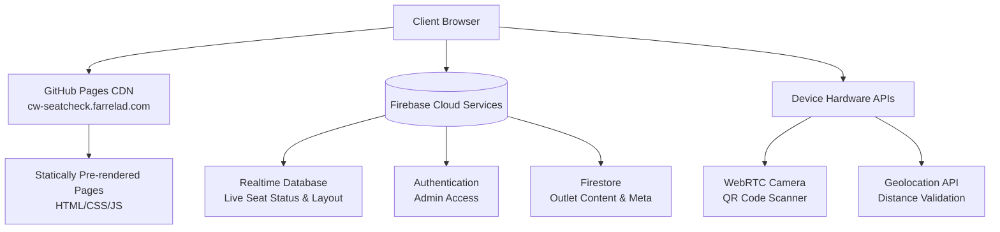

# AI Agent & Developer Architecture Guide

This guide provides deep technical documentation for AI coding agents and developers working on **CW-COFFEE-SeatCheck**.

---

## 1. System Architecture



### Route Structure & Static Generation

All dynamic routes in `src/app` must pre-render every available path via `generateStaticParams()`:

- `src/app/page.tsx`: Landing page with promotional banners, news, and outlet highlights.
- `src/app/category/outlet/page.tsx`: Outlet directory listing all CW Coffee locations.
- `src/app/category/outlet/[outletName]/page.tsx`: Specific outlet view with real-time capacity overview and floor plan preview.
- `src/app/category/outlet/[outletName]/checking/page.tsx`: Live seat monitoring and QR check-in grid.
- `src/app/admin/outlet/[outletId]/page.tsx`: Admin management interface for toggling seats and managing layouts.

---

## 2. Firebase Realtime Database Schema

Seat occupancy is synchronized in real time via Firebase Realtime Database:

```
/seats
  /{outletId}
    /{zoneName}
      /{seatId}
        type: "single" | "double" | "group" | "bar" | "outdoor"
        status: "available" | "used"
        face?: "top" | "bottom" | "left" | "right"
        updatedAt: number (epoch ms)
        checkedInAt?: number (epoch ms)
        sessionId?: string

/checkins
  /{outletId}
    /{sessionId}
      seatId: string
      zone: string
      outletId: number
      checkedInAt: number (epoch ms)
      checkedOutAt: number | null
      duration: number | null
      sessionId: string
      checkInLocation?: {
        latitude: number
        longitude: number
        accuracy: number
      }
```

### Path Helper

Always use the centralized path helpers defined in `src/lib/firebase/database.ts`:

- `DB_PATHS.zoneSeats(outletId, zoneName)`
- `DB_PATHS.seat(outletId, zoneName, seatId)`
- `DB_PATHS.checkin(outletId, sessionId)`

---

## 3. Geolocation & Check-In Validation

To prevent off-site check-ins, the client validates the user's distance against the outlet's geographic coordinates using the **Haversine formula** (`src/lib/services/geolocation-service.ts`):

- **Tolerance**: Defined per outlet (`outlet.checkInRadius`, default `50` meters).
- **Graceful Fallback**: If an outlet lacks coordinates, validation is skipped with a logged notice.
- **Accuracy Check**: If GPS accuracy is insufficient, warn the user rather than failing silently.

---

## 4. Hardware Lifecycle (Camera & QR Scanner)

1. **Permission Handling**:
   - Always query camera permissions gracefully using `navigator.mediaDevices.getUserMedia`.
   - Release media tracks (`track.stop()`) immediately upon modal close or component unmount.
2. **Scanner Performance**:
   - Use dynamic imports for `@zxing/library` so that the large scanning library is only fetched when the user activates the camera modal.
   - Scan loop runs via `requestAnimationFrame` with a synchronous state flag (`isScanningRef`) to prevent redundant frames after a valid barcode is found.

---

## 5. Testing & CI/CD Contracts

### Test Levels:

- **Unit Tests (`tests/`)**:
  - Jest with `jsdom` testing utility functions, Firebase configs, and component rendering.
  - Run via `pnpm test`.
- **E2E Tests (`cypress/`)**:
  - Cypress tests validating critical user paths (seat reservation, QR scanning simulation, admin auth).
  - Run via `pnpm run e2e`.

### CI/CD Pipeline Checks:

- No warning policy: All pull requests must pass `eslint` with **0 warnings** and **0 errors**.
- Formatter: Prettier with auto EOL and strict indentation.
- Type Safety: TypeScript compiler with `noEmit`.
